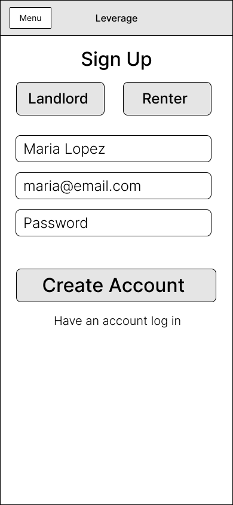
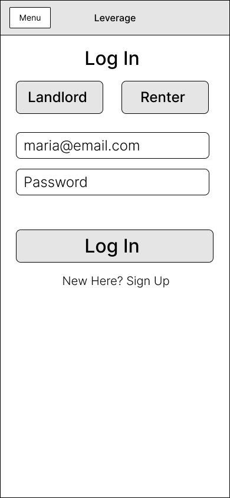
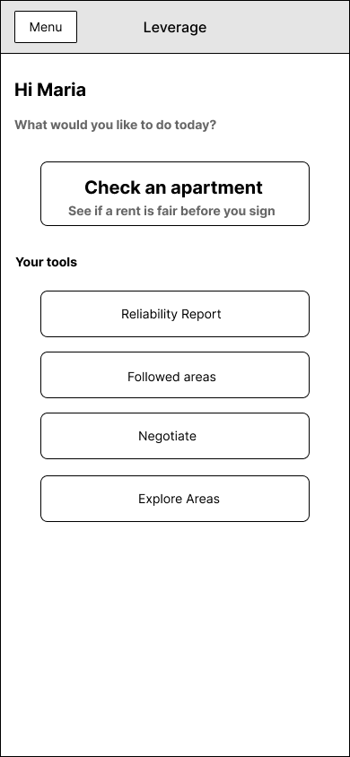
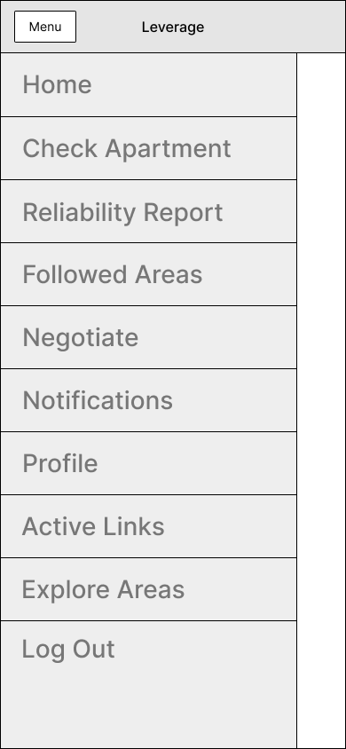

# UX Design: Leverage

Leverage helps renters check whether an apartment's asking rent is fair, build a private Reliability Report from their bank-verified rent payments to share with landlords, and negotiate rent with real data.

## Clickable Prototype

[**Open the Figma prototype**](https://www.figma.com/proto/QRlOL96wohPQkAEg6ZKBys/Leverage-Wireframes?node-id=18-58&p=f&scaling=min-zoom&content-scaling=fixed&page-id=0%3A1&starting-point-node-id=18%3A58&show-proto-sidebar=1) (anyone with the link can view)

How to use it:
- The prototype starts on **Home**. Click buttons, rows and links to move between screens.
- The **Menu** button in the top bar opens the menu popup on every screen. Click **Menu** again to close it.
- There are **separate flows** for renters (start at Sign Up or Home) and landlords (start at Landlord Home, or at Landlord's Report View when opened from a share link without an account).

## App Map

The app map shows every screen and how users move between them. Renters go from Log in or Sign Up to Home, which leads to Check Apartment, Connect Bank, Followed Areas, Negotiation Message, Notifications, Profile and Explore Areas. Landlords go from Sign Up or Log in to Landlord Home, then Received Reports and the Landlord's Report View, which can also be opened directly from a share link without an account.

---

## Wireframes

### 1. Sign Up
Where a new user creates an account with name, email and password. At the top they choose whether they are signing up as a **Renter** or a **Landlord**. A link at the bottom goes to Log in. Renters go to Home after signing up; landlords go to Landlord Home.

### 2. Log in
Where a returning renter logs in with email and password. A link at the bottom goes to Sign Up. Logging in takes the user to Home.

### 3. Home
The renter's main screen after login. A large "Check an apartment" button sits at the top, with shortcuts underneath to the Reliability Report, Followed areas, Negotiate and Explore Areas. The **Menu** button in the top bar opens the menu popup.

### 4. Menu Popup
Opens on top of the current screen when the renter taps **Menu**. It links to every main section: Home, Check Apartment, Reliability Report, Followed Areas, Negotiate, Notifications, Profile, Active Links, Explore Areas and Log Out. Tapping **Menu** again closes it.

### 5. Check apartment
A form where the renter enters the address, asking rent, and number of bedrooms and bathrooms, then taps "Check price".

### 6. Price result
Shows the asking rent next to the nearby price range and how far above or below the local average it is. Two buttons lead on to "See comparable apartments" and "See rent trends".

### 7. Comparable apartments
A list of similar apartments nearby, each with rent, bedrooms and rough location, so the renter can judge whether the asking price is fair.

### 8. Connect Bank
Where the renter starts a Reliability Report by connecting a bank account. A short explanation says what will be checked. Connecting takes the user to the report preview.

### 9. Reliability Report Preview
Shows the report as it will be shared: months of verified payments, on-time history, income stability, and rent compared to income. Each section has an on/off switch so the renter chooses what to share. The "Share" button opens the share link popup, and a link leads to Active Share Links.

### 10. Share Link Popup
A popup on top of the report preview showing the private link and a "Copy link" button. Tapping it shows the "Link copied" version.

### 11. Share Link Copied
The same popup after the link is copied, with a confirmation message. Continuing takes the user to Active Share Links.

### 12. Active Share Links
Lists every share link the renter has created, with its creation date and a switch to turn it off, so the renter stays in control of who can see the report.

### 13. Rent trends
Shows how average rent in an area has changed over recent years in a chart, with a "Follow this area" button that adds the area to the renter's followed areas.

### 14. Rent trends - following
The same Rent trends screen after the renter taps "Follow this area". The button changes to **Following** to show the area is now in their followed areas.

### 15. Followed areas
A list of the areas the renter follows, each with its recent rent change and an "Unfollow" option. Tapping an area opens its rent trends.

### 16. Explore areas
Lets the renter search for any area or address, and shows popular areas with their rent change over the past year and average rent. Tapping an area opens its rent trends.

### 17. Negotiation message
Shows a summary of comparable rents and a generated negotiation message in an editable text box. "Copy message" copies it and shows the confirmation version. A link lets the renter record what happened afterward.

### 18. Negotiation message - copied
The same screen after the message is copied, with a "Message copied" confirmation. "Record what happened" opens the Record outcome screen.

### 19. Record outcome
The renter picks an outcome (rent lowered, increase accepted, application accepted, other), adds a short note, and saves. Saving returns to Home.

### 20. Profile
Editable name, email and city fields with a "Save" button. Saving returns to Home.

### 21. Notifications
All notifications in one list, newest first. Unread ones look different from read ones. Tapping a notification opens the related screen, such as rent trends for a followed area or the negotiation screen.

### 22. Landlord Home
The landlord's main screen after logging in. It has a "Received reports" button and a short list of the most recent reports renters have shared.

### 23. Landlord Menu
Opens when a landlord taps **Menu**. It links to Home, Received reports and Log Out.

### 24. Received reports
Every Reliability Report renters have shared with the landlord, split into new and earlier, each with the renter's name, the date and a View button that opens the report.

### 25. Landlord's Report View
A renter's Reliability Report as the landlord sees it, opened from Received reports or directly from a share link without an account. It shows the renter's first name, only the sections the renter chose to share, and a "Verified by Leverage" badge with the date.

